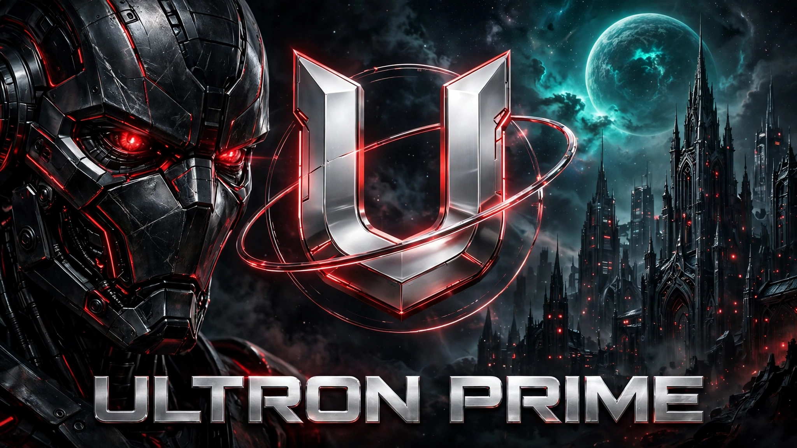

# ULTRON PRIME BugHunter

> A rebranded, enhanced fork of [elementalsouls/Claude-BugHunter](https://github.com/elementalsouls/Claude-BugHunter) for the [ULTRON PRIME](https://www.youtube.com/@ultronprime_zero) YouTube channel · **86 skills** (83 original + 3 ULTRON PRIME) · 15 slash commands · **681 disclosed-report patterns** across 24 vulnerability classes · new `ultron` CLI with VRT-aware auto-triage + single-file HTML reports · one-click installer.
>
> **This is a fork, not original work.** The skill bundle, engine, `cbh` CLI, and all 83 original skills were built by **[Sachin Sharma](https://www.linkedin.com/in/sachinsharma8080/)** ([elementalsouls](https://github.com/elementalsouls)) and are used here under the MIT License (code) and CC BY 4.0 (skill content) — see `LICENSE`, `LICENSE-CONTENT`, and `NOTICE`. ULTRON PRIME's additions are listed under **What's new** below. Original author credit is preserved in full.

---

## What is this?

`ULTRON PRIME BugHunter` takes the original `claude-bughunter` bundle — a drop-in skill set that makes Claude Code behave like a senior bug-hunting researcher / red-team operator — and rebuilds it in ULTRON PRIME's black / red / silver theme with extra tooling for the channel's rebuild-and-improve series:

- **Think** — `bb-methodology` + `redteam-mindset`: the 5-phase workflow and operator discipline.
- **Hunt webapps** — 58 `hunt-*` skills curated from 681 disclosed HackerOne reports: detection patterns, payloads, bypass tables, chain templates.
- **Hit the perimeter** — enterprise platform chains (M365/Entra, Okta, vCenter, SSL-VPN, SharePoint, cloud IAM).
- **Ship it** — `triage-validation` + reporting + `evidence-hygiene`: the 7-Question Gate, VRT-aware severity, PII redaction.
- **NEW — ULTRON PRIME layer** — the `ultron` CLI, auto-triage scorer, HTML reports, and three channel-themed skills (`ultron-protocol`, `ultron-bypass-lab`, `ultron-override`) matching the channel's PROTOCOL / BYPASS / OVERRIDE series.

All 86 skills auto-load by topic in Claude Code — describe what you're testing in plain English and the relevant skill loads.

---

## ⚠️ Scope & authorization — read this first

**Authorized testing only.** Use this bundle solely against assets you **own** or have **written authorization** to assess:

- Bug-bounty programs where the asset is explicitly in scope (HackerOne, Bugcrowd, Intigriti, Immunefi, YesWeHack)
- Authorized penetration tests under a signed Rules of Engagement
- Capture-the-flag competitions, your own infrastructure, lab targets (DVWA, OWASP Juice Shop, Hacker101)

**Out of scope by design** (same as the original — see `SECURITY.md`): weaponizing 0-days against unauthorized targets, post-exploitation / persistence, C2 frameworks, malware, mass unauthorized scanning, credential stuffing, internal Active Directory takeover, and any activity violating the CFAA, UK Computer Misuse Act, India's IT Act, or equivalent law. If a finding needs out-of-scope work to prove impact, the gates default to **DOWNGRADE** or **KILL** — never "exploit further to prove it."

The `ultron scan` command is a pre-flight scope gate, not a scanner: it refuses to proceed unless the target is listed in your scope file.

---

## What's new in the ULTRON PRIME version (v1.0.0)

| Addition | What it does |
|---|---|
| `ultron` CLI (`ultron.py`) | `scan` (scope gate), `triage`, `report`, `skills`, `version`. Prints the ULTRON PRIME ASCII banner. Stdlib only, no new dependencies. `cbh` still works unchanged. |
| Auto-triage scorer (`ultron/triage.py`) | VRT-aware severity, CVSS-like 0–10 score, confidence, duplicate detection (fingerprinting), and enforcement of the 7-Question Gate. Unit-tested (`tests/test_ultron_triage.py`, 10 tests). |
| HTML report generator (`ultron/report.py`) | Single-file report in the black/red ULTRON PRIME theme: findings, severity badges, evidence, gate results, and a scope + authorization statement on every report. |
| `ultron-protocol` skill | AI prompt-architecture testing on **your own** models / authorized targets only, with an authorization checklist and guardrail measurement method. |
| `ultron-bypass-lab` skill | Local-model / self-hosted setup testing on your own hardware — the cheap self-hosted route, measured with numbers. Authorized only. |
| `ultron-override` skill | Model-release teardown checklist: frozen 10-prompt test set, before/after scores, "what got patched", anti-hype rules. |
| One-click installer (`scripts/install-ultron.sh` / `.ps1`) | Installs all 86 skills + commands to Claude Code, Codex, OpenCode, Hermes, and AntiGravity paths, plus the `ultron` CLI. |
| ULTRON PRIME branding | Channel logo + banner in `assets/` (`ultron-prime-logo.png`, `ultron-prime-banner.png`), matching the YouTube channel. |
| Sample demo | `sample-findings.json` (3 fictional findings against `example.com`, clearly labelled SAMPLE) + generated `sample-report.html` proving the pipeline. |

---

## Quickstart

```bash
git clone <your-fork-url> ULTRON-PRIME-BugHunter
cd ULTRON-PRIME-BugHunter

# macOS / Linux — one-click install (skills + commands + ultron CLI)
bash scripts/install-ultron.sh --all

# Windows (PowerShell)
pwsh ./scripts/install-ultron.ps1 -All
```

Or use it without installing — everything runs from the clone:

```bash
# 1. Scope gate — target must be in your scope file (see scope.example.txt)
python3 ultron.py scan --target example.com --scope scope.example.txt

# 2. List all 86 skills
python3 ultron.py skills

# 3. Triage findings (VRT score + 7-Question Gate)
python3 ultron.py triage sample-findings.json

# 4. Build the HTML report
python3 ultron.py report sample-findings.json --out sample-report.html

# 5. Original CLI still works
python3 scripts/cbh.py --help
```

The original plugin path also still works — in `.claude-plugin/plugin.json` the
plugin is renamed to `ultron-prime-bughunter`; install the original
`claude-bughunter@elementalsouls` plugin from the upstream repo if you want
upstream updates instead of this fork.

---

## The `ultron` CLI

```
ultron scan --target <domain> --scope <file>   pre-flight scope check (refuses out-of-scope targets)
ultron triage <findings.json> [--out triage.json]
ultron report <findings.json> --out report.html
ultron skills                                  list all 86 skills
ultron version
```

Findings JSON is a list (or `{"findings": [...]}`) of objects with `title`,
`type` (e.g. `xss-stored`, `idor`, `sqli`, `rce`, `ssrf`), `target`,
`endpoint`, `evidence` (list of strings), `impact`, `reproducible`,
`in_scope`, `accepted_impact`. See `sample-findings.json` for the exact shape.

Triage verdicts: **REPORT-READY** (passed all 7 gate questions, evidence-backed),
**DOWNGRADE** (low confidence or sub-Medium score — gather more evidence),
**KILL** (failed a gate question, out of scope, or duplicate). Exit code is
1 when any finding is killed, so it plugs into CI cleanly.

---

## Skills (86)

- **83 original skills** — unchanged from elementalsouls/Claude-BugHunter v2.1.0
  (58 `hunt-*`, recon/OSINT, enterprise chains, reporting, validation gates).
- **3 ULTRON PRIME skills** — `ultron-protocol`, `ultron-bypass-lab`,
  `ultron-override` (see `skills/ultron-*/SKILL.md`; each carries its own
  scope + authorization warnings).

Full list: `ultron skills` (or `python3 ultron.py skills` from the clone).

---

## Demo (sample data)

`sample-findings.json` contains 3 **fictional, clearly labelled SAMPLE**
findings against `example.com` (a reserved documentation domain — never a
real target). The included `sample-report.html` was generated from it:

- Stored XSS in profile bio — **High 7.3/10, REPORT-READY**
- IDOR on another user's invoice — **High 8.0/10, REPORT-READY**
- Clickjacking with no demonstrated impact — **Low 0.8/10, KILL** (fails Q1/Q2/Q4/Q6)

Re-run it yourself: `python3 ultron.py triage sample-findings.json` and
`python3 ultron.py report sample-findings.json --out sample-report.html`.

---

## Tests

```bash
python3 -m py_compile ultron.py ultron/*.py tests/test_ultron_triage.py
python3 -m unittest tests.test_ultron_triage -v        # 10 ULTRON PRIME tests
PYTHONPATH=".:engine" python3 -m unittest discover -s engine   # original engine tests
PYTHONPATH=".:engine" python3 -m unittest discover -s tests    # original tests/
python3 scripts/test_triage.py                          # original cbh triage self-check
python3 engine/scope.py --selftest
```

pytest is **not** required — everything above is stdlib `unittest` (the
original CI uses `python -m unittest discover`).

---

## License & attribution

- **Code:** MIT License — Copyright (c) 2026 Sachin Sharma (original),
  see `LICENSE`. ULTRON PRIME additions are also MIT.
- **Skill/documentation content:** CC BY 4.0 — see `LICENSE-CONTENT`.
- **Original project:** https://github.com/elementalsouls/Claude-BugHunter
- **ULTRON PRIME channel:** https://www.youtube.com/@ultronprime_zero

If you use this fork, keep the attribution above and in `NOTICE`. Do not
present the original 83 skills as ULTRON PRIME's own work — they are
Sachin Sharma's, used here with credit under their licenses.

---

## Video

The rebuild is covered on ULTRON PRIME — see `VIDEO_PLAN.md` for the
8–10 minute video outline (hook, what the original does, what's new,
live demo, outro + links).
